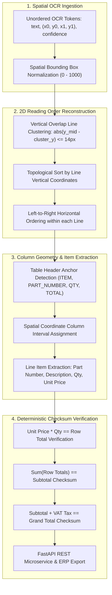

<div align="center">

# 📑 Multimodal Document Intelligence
### 2D Spatial Coordinate Clustering, Reading Order Topological Sorting & Tabular Checksum Reconciliation

[](https://github.com/yakupakcy36/multimodal-document-intelligence/actions/workflows/ci.yml)
[](https://www.python.org/downloads/release/python-3120/)
[](https://opensource.org/licenses/MIT)
[](https://fastapi.tiangolo.com)
[](https://www.docker.com/)

</div>

---

## 📌 Executive Summary

Industrial enterprises handle millions of complex multi-column documents every month: engineering specification sheets, Bill of Materials (BOM), and equipment purchase orders. Standard naive OCR and text-dumping Large Language Models fail consistently because:
1. **Unordered Token Ingestion**: OCR engines output words in arbitrary bounding box coordinate order rather than natural reading flow.
2. **Column Misalignment**: Wrapping descriptions cause row tokens to drift across visual column borders.
3. **Hallucinated Financials**: Language models cannot perform zero-defect mathematical checksum verification required by enterprise ERP systems (SAP, Oracle).

**`multimodal-document-intelligence`** is a zero-API-cost, high-speed spatial document layout engine ($<4\text{ ms / document}$). It reconstructs 2D reading order via vertical line clustering and horizontal interval mapping, extracts structured line-item tables, and executes deterministic arithmetic checksum audits ($\sum \text{Item} = \text{Subtotal}$, $\text{Subtotal} + \text{VAT} = \text{Grand Total}$).

---

## 🏗️ Architecture & Spatial Processing Pipeline



---

## 🔬 Spatial Algorithms & Mathematical Formulation

### 1. Vertical Line Clustering
For an OCR token $T_i$ with bounding box $(x_0^i, y_0^i, x_1^i, y_1^i)$, its vertical centroid is:
$$y_{\text{mid}}^i = \frac{y_0^i + y_1^i}{2}$$

A token is assigned to line cluster $L_k$ if its vertical distance to the cluster centroid satisfies:
$$\left| y_{\text{mid}}^i - \frac{1}{|L_k|} \sum_{T_j \in L_k} y_{\text{mid}}^j \right| \le \tau_y \quad (\tau_y = 14\text{ px})$$

### 2. Column Interval Spatial Projection
Given detected table column intervals $C_m = [x_{\text{start}}^m, x_{\text{end}}^m]$, a token's horizontal midpoint $x_{\text{mid}}^i = \frac{x_0^i + x_1^i}{2}$ maps to column $C_m$:
$$\text{Column}(T_i) = \arg\min_m \text{dist}\left(x_{\text{mid}}^i, C_m\right)$$

### 3. Arithmetic Reconciliation Checksum
$$\mathcal{E}_{\text{row}}[k] = \left| \text{Qty}[k] \times \text{UnitPrice}[k] - \text{Total}[k] \right| < \epsilon$$
$$\mathcal{E}_{\text{subtotal}} = \left| \sum_{k=1}^K \text{Total}[k] - \text{Subtotal} \right| < \epsilon$$
$$\mathcal{E}_{\text{grand}} = \left| \text{Subtotal} + \text{VAT} - \text{GrandTotal} \right| < \epsilon \quad (\epsilon = \$0.05)$$

---

## 🚀 Quick Start

### 1. Local Setup
```bash
git clone https://github.com/yakupakcy36/multimodal-document-intelligence.git
cd multimodal-document-intelligence

python -m venv .venv
source .venv/bin/activate  # On Windows: .venv\Scripts\activate
pip install -r requirements.txt
```

### 2. Run Benchmark CLI
```bash
python -m src.pipeline --docs 50
```

Sample output:
```text
====================================================================
MULTIMODAL DOCUMENT INTELLIGENCE: SPATIAL LAYOUT & CHECKSUM BENCHMARK
====================================================================

Evaluated 50 complex engineering procurement documents:
  Item Precision               : 100.0%
  Item Recall                  : 100.0%
  Item Extraction F1-Score     : 100.0%
  PO Number Accuracy           : 100.0%
  Arithmetic Checksum Pass Rate: 100.0%
  Average Processing Latency   :  3.91 ms / document

[SUCCESS] Document intelligence benchmark completed successfully.
```

### 3. Run Test Suite
```bash
pytest tests
```

---

## 🌐 Production REST API

Start the FastAPI microservice:
```bash
uvicorn api.app:app --host 0.0.0.0 --port 8000
```
Interactive docs: `http://localhost:8000/docs`

### Sample Request (`POST /parse/synthetic-demo`):
```bash
curl -X POST "http://localhost:8000/parse/synthetic-demo" \
     -H "Content-Type: application/json" \
     -d '{
       "seed": 42
     }'
```

### Sample Response:
```json
{
  "document_id": "DEMO-PO-SEED-42",
  "po_number": "PO-2026-ENG-2124",
  "document_date": "2026-03-14",
  "line_items": [
    {
      "item_index": 1,
      "part_number": "6ES7512-1DK01-0AB0",
      "description": "CPU 1512C-1 PN Compact Controller",
      "qty": 4,
      "unit_price": 1250.0,
      "total_price": 5000.0,
      "arithmetic_valid": true
    }
  ],
  "subtotal": 12840.5,
  "tax_amount": 2568.1,
  "grand_total": 15408.6,
  "checksum_passed": true,
  "reconciliation_notes": "[OK] Arithmetic verified: 4 items sum 12840.50 + VAT 2568.10 = Grand Total 15408.60",
  "ocr_quality_score": 0.982
}
```

---

## 🐳 Docker Containerization

Run with Docker Compose:
```bash
docker-compose up --build -d
```

Verify status:
```bash
curl http://localhost:8000/health
```

---

## 📊 Repository Layout

```text
├── api/
│   ├── app.py                  # FastAPI server & lifespan handlers
│   ├── schemas.py              # Pydantic v2 schemas
│   └── __init__.py
├── src/
│   ├── config.py               # Coordinate thresholds & line tolerances
│   ├── generator.py            # Physics & geometry synthetic PO generator
│   ├── parser.py               # Spatial column extractor & checksum engine
│   ├── spatial_layout.py       # 2D line clustering & topological sorting
│   ├── pipeline.py             # Precision, recall, & F1 benchmark runner
│   └── __init__.py
├── tests/
│   ├── test_api.py             # REST endpoint integration tests
│   ├── test_generator.py       # Bounding box coordinate tests
│   ├── test_parser.py          # Arithmetic checksum validation tests
│   └── test_spatial_layout.py  # 2D reading order sort tests
├── Dockerfile
├── docker-compose.yml
├── requirements.txt
├── pytest.ini
└── README.md
```

---

## 📄 License
This project is open-source under the [MIT License](LICENSE).
